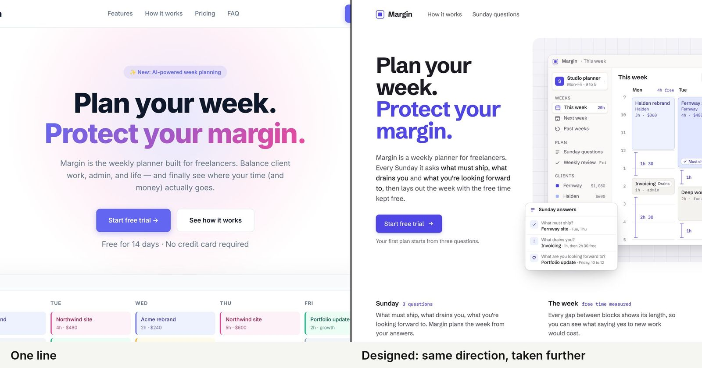

# Agentic Design Harness



A persistent design environment for building and reviewing interfaces. It connects eleven bundled
design workflows to project briefs, approved direction, reusable systems, components and decisions,
so subsequent work can stay consistent across sessions.

Everything it needs is in this repository: the eleven skills are bundled and locked here, and the
harness supplies project context and wiring rather than another set of aesthetic rules. It does not
fetch, require or run anything from another repository.

## Start a new project

If an agent opens this harness and is asked to create a page or application, it should first
create a separate sibling project:

```bash
python3 scripts/create-project.py --name workshop-portal
```

Use the returned `project_root` for all subsequent work. A new project receives an independent working copy of the harness, the full pinned
skill set and project context for builds, reviews, refinement and brand/system work. It does not
install anything globally, change account settings, choose an application framework or publish.
Brand/product discovery starts in that copy using `docs/agentic-design-harness/PROJECT-START.md`.
An existing name receives a numeric suffix. An explicit new absolute destination is supported
with `--destination`; existing destinations are refused by this helper.

For a scaffolder requiring an empty directory, stage its application separately and merge it
without replacing the harness, contexts or existing project files. Keep agent tooling out of
application compilation and deployment. An installed working copy cannot seed another product;
use the reusable clean source for each new project.

## Add to an existing project

```bash
bash scripts/init.sh /absolute/path/to/project

# Coexist with another engineering harness:
bash scripts/init.sh --path-scoped /absolute/path/to/project
```

The installer is additive: unrelated files and skills remain intact. A different same-named skill
is a collision, never silently replaced. Existing instruction files are preserved; the installer
writes the integration report and returns **INSTALLED BUT NOT ACTIVATED** (exit 4).
No global or account installation happens.

Standalone mode places skills in `.claude/skills/`. Path-scoped mode uses `.agents/skills/`, puts
instructions in `design/agentic-design-harness/HARNESS.md` and a router in `.agents/rules/agentic-design-harness.md`. Conflicting
skills receive review candidates in `.agents/skill-candidates/agentic-design-harness/`. An existing `AGENTS.md`, `CLAUDE.md`, `.agents/` or `harness.config.yaml` selects coexistence mode
automatically. Existing project entrypoints are preserved. The installer writes
`docs/agentic-design-harness/INSTALLATION.md` with the exact proposed routing/import lines; add them
to your development harness's canonical source, regenerate its views if needed, then verify
with `bash scripts/dh-host-check.sh .`. Re-running installation can verify completed integration. The installed marker
uses relative paths so moving the project does not break its wiring.

## What runs

| Request | Workflow |
|---|---|
| References, concepts, alternatives or help choosing | `direction-study`: per-source visual guides, faithful/loose/compatible-mix discovery, narrow previews for feedback; independent reviews before a completed comparison and **STUDY — DECISION REQUIRED** |
| Build after choosing a direction | `design-build`: direction → design system → implementation → render → delegated review |
| Review | `design-review`: separate distinctiveness, UI and whole-product lenses; IA and source similarity as applicable; one bounded repair and fresh finish review |
| Refinement | `design-refine`: critique first; editing only within authorized scope |
| Brand/style guidelines and system work | `ui-design-system` Create / Extract / Reconcile / Audit–Drift; compatible machine-readable visual brand through `brand-to-system` |

`ui-design-principles` supplies decision-time guidance, `distinctiveness-review` assesses generic
AI defaults, `ui-design-review` handles correctness and measurements, `ia-review` handles structure,
and `starter-directions` is optional when direction is genuinely absent. The workflows allow techniques
such as gradients or rounded shapes when they serve the direction and earn their place; accessibility
and UI/IA fundamentals remain binding. There is no default house style.

Standalone web studies produce local HTML/CSS proofs, an index and desktop/mobile screenshots in
the project. Existing apps, native work and explicitly requested design-file formats keep their
appropriate output. A study does not create a production design system or claim readiness.
Initial proposals may pause at **STUDY PREVIEW — FEEDBACK REQUIRED** before full reviews, with no
positive recommendation or completed-review claim. Design principles still guide each preview.
Reference extraction preserves colour roles and coverage, typography, components and imagery;
contrasting sources stay alternative styles unless deliberate compatible combinations are requested.

## Execution modes

The harness resolves the local locked payload before choosing a design approach. With verified
native registration, use the host's native invocation. Otherwise, **folder-execution** selects and
executes the local workflow and required supporting steps; reading a file alone is not execution.
Reviewers use the same pinned root. Available-but-unused external skills do not invalidate a run;
an active external design producer must not silently replace the bundled workflows.

Claude Code's local project layout is included. Other file-capable agents can use folder-execution;
`AGENTS.md` explicitly requires reading product and cheat-sheet context even without `@` expansion.
For Cowork, this harness supports local folder execution; selecting a folder does not certify native
skill registration. The harness supplies no plugin (`"plugin": null` in `docs/harness-package.json`).
Live native host activation has not been tested here.

The static checks cannot prove model compliance, creative quality, hidden host guidance, or that a
fresh reviewer actually ran. Missing review/rendering remains incomplete, never an invented pass.

## Persistent context

`design/product.md` and `design/cheatsheet.md` accompany the compact agent entry. Brief, surface/state
map, full `DESIGN.md` / `tokens.json`, brand, components and references load only when relevant.
Production creates, extracts or reconciles a system as needed; later feature work consumes it.
Approved contracts are not silently rewritten during implementation or review.

Knowledge separates decisions, taste, lessons, debt and reusable patterns. A repeated lesson becomes
an always-applied rule only when no better mechanical owner exists and a person accepts it. Routine
work creates no extra record. Upstream feedback remains local until a person chooses to send it.

## Verify the wiring

```bash
bash scripts/check-skill-sync.sh
bash scripts/host-check.sh
bash scripts/budget.sh
bash scripts/smoke.sh

# Inside an installed project:
python3 scripts/dh-preflight.py --root .
bash scripts/dh-check.sh page.html
```

Preflight checks every pinned file and discovers actual local paths, including path-scoped installs.
The floor measures HTML contrast, narrow-width overflow, padding, tokens, headings, semantic main and
targets. It is web-only: green measurements are not a craft review or readiness declaration. Missing
browser checks return **not verified**; `DH_STRICT=1` makes incomplete smoke verification fail.
Use `CHROME_PATH` to identify a reachable Chrome/Chromium when necessary. Requirements: Bash, Python 3.9+,
Node.js 22+ and a browser for rendered measurements. No package-manager installation is required.

`bash scripts/package.sh` generates local versioned ZIP/tar downloads and checksums after checks pass.
It does not publish or install anything. See [integration notes](docs/INTEGRATION.md) for the package
configuration, output boundaries and acceptance scope.

## Background reading

Steven Smith describes the approach to context, references, systems and review. Some examples use
earlier versions of these workflows:

- [English: Designed, not generated](https://stevensmith.dev/writing/designed-not-generated)
- [日本語: 生成ではなく、デザインを。](https://stevensmith.dev/ja/writing/designed-not-generated)

## Licence and provenance

MIT licensed. `docs/harness-package.json` declares this package's helpers, workspace rules and
supported execution modes; `docs/skills-lock.json` authenticates all eleven bundled workflows. No
Hallmark or Impeccable runtime/code dependency is included; `NOTICE` credits their influence.
